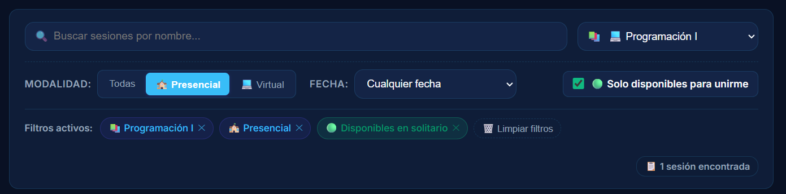
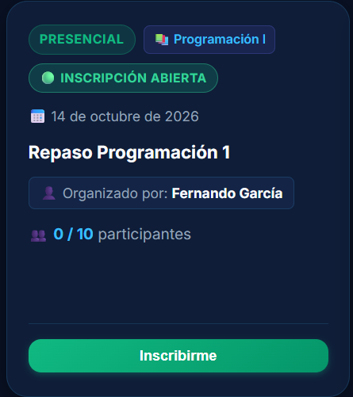
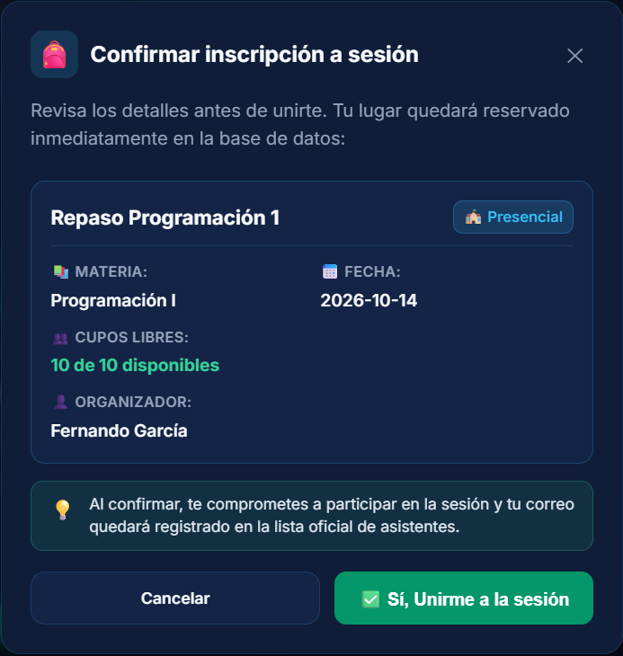

# 📋 Registro de Hallazgos de Interacción (Clase 16)

**Materia:** Interacción Hombre-Computador (ELC106)  
**Proyecto:** StudyMatch 📚🤝  
**Funcionalidad:** *"Encontrar una sesión de estudio y unirse"*  
**Fecha:** 15 de octubre de 2026  

---

## 📑 Tabla Oficial de Hallazgos de Interacción (Diapositiva 19)

| Hallazgo | Captura obligatoria | Justificación breve | Estado al terminar |
|---|---|---|:---:|
| **Fitts** | **Acción difícil de alcanzar:**   | **Tamaño, distancia o área activa:** Los botones de confirmación y salida de emergencia en el modal presentaban un área táctil reducida (~36px), exigiendo alta precisión motora y aumentando el tiempo de adquisición del objetivo. Se prioriza para ampliar el área activa al estándar ergonómico táctil de **48px**. | **Documentado.** |
| **Hick** | **Opciones que compiten:**   | **Cantidad, agrupación o prioridad:** En la barra superior de filtros compiten simultáneamente 5 alternativas al mismo nivel visual (buscador, 3 modalidades, selector de materia, selector de fecha y switch directo), incrementando el tiempo de procesamiento antes de iniciar la búsqueda. | **Documentado.** |
| **Carga cognitiva** | **Información que exige esfuerzo:**   | **Qué debe recordar, interpretar o comparar:** En las tarjetas de sesión, el aforo se presentaba en cifras brutas (`0 / 10 participantes`), obligando al usuario a realizar restas mentales para calcular y recordar los cupos libres disponibles mientras compara sesiones. | **Documentado.** |

---

## 🛠️ Priorización y Corrección Implementada (Commit 2)

### Hallazgo seleccionado: **Ley de Fitts (Área activa y tamaño táctil)**

* **Problema:** Botones con tamaño pequeño que exigen precisión motora en el momento crítico de la decisión.
* **Solución aplicada en código:**
  1. Se implementó una **área activa mínima de 48px** (`min-height: 48px; padding: 12px 24px; font-size: 1rem;`) en los botones `.btn-confirm-join` y `.btn-cancel` dentro de [`frontend/src/styles/Dashboard.css`](../frontend/src/styles/Dashboard.css).
  2. En [`frontend/src/pages/Dashboard.jsx`](../frontend/src/pages/Dashboard.jsx), se sincronizó el feedback reactivo `⏳ Inscribiendo...` en el botón durante la petición asíncrona para confirmar visualmente la interacción.
* **Evidencia del después (código funcionando):**  
  
