# 🕘 Decisiones de Interacción · Historial de Participación (Tarea 4)
**Proyecto:** StudyMatch 📚🤝  
**Materia:** Interacción Hombre-Computador (ELC106)  
**Clase:** Clase 16 · Decisiones de interacción (Tarea 4)  
**Funcionalidad nueva:** *"Mi historial"*: historial de participación en sesiones de estudio  
**Pregunta que responde:** **¿En qué sesiones participó la persona?** *(Diapositiva 21)*  
**Issue Principal en GitHub:** [#12 (Historial de participación en sesiones de estudio)](https://github.com/FernandojCg737/2do_Proyeccto_IHC/issues/12)  
**Fecha:** 19 de octubre de 2026  

---

## 📑 Resumen Ejecutivo

Siguiendo la **Clase 16 (Diapositivas 20 a 24)**, se construyó un historial **pequeño, completo y comprobable**: cada acción relevante (unirse, crear, cerrar o eliminar una sesión) genera un evento **persistido en PostgreSQL**, el usuario autenticado consulta **solo su propio historial**, ordenado del más reciente al más antiguo, y la interfaz aplica las tres leyes vistas en clase.

> **Regla docente (Diapositiva 20):** *"Historial no es un texto agregado a la pantalla. Es una nueva funcionalidad conectada a datos reales."*

### Matriz de las tres decisiones

| Ley | Pregunta de clase (Diapositiva 23) | Problema antes | Decisión aplicada |
|---|---|---|---|
| **Fitts** | *La entrada al historial y la acción frecuente tienen un objetivo fácil de alcanzar.* | No existía ningún acceso al historial; la ruta `/historial` devolvía al inicio. | Acceso **"Mi historial"** en el sidebar y en la barra inferior móvil (≥ 48 px), fila completa clicable para ver el detalle y botón grande **"Buscar sesiones"** en el estado vacío. |
| **Hick** | *Los tipos de eventos, estados o filtros no compiten todos sin organización.* | 5 controles de filtro al mismo nivel y ninguno respondía "¿en cuáles participé?". | Un único control segmentado de **3 opciones** (`Todas · Me uní · Organicé`) con su cantidad; los estados son **etiquetas**, no filtros. |
| **Carga cognitiva** | *Cada evento muestra primero lo necesario y permite comprender qué pasó sin recordar otras pantallas.* | Había que revisar tarjeta por tarjeta; en sesiones finalizadas o cerradas **no se indicaba** que el usuario participó. | Cada evento dice **qué pasó, con qué sesión, cuándo y su estado actual** en una línea; el detalle (fecha, modalidad, organizador, cupos) se muestra **bajo demanda**. |

---

## 🔍 Fichas de las Decisiones

```
===============================================================================
Decisión 1 · Ley de Fitts: acceso al historial y acción frecuente
===============================================================================
```
* **Principio de clase:** *"La entrada al historial y la acción frecuente tienen un objetivo fácil de alcanzar."*
* **Problema observado (antes):**
  * No había ninguna entrada al historial en el sidebar, en la barra inferior móvil ni en el perfil.
  * El ítem *"Mis sesiones (5)"* del sidebar llevaba a **todas** las sesiones, no a las del usuario, sugiriendo un acceso que no existía.
  * Escribir la ruta `/historial` redirigía a la página de inicio.
* **Ubicación en pantalla:** Sidebar (escritorio), barra de navegación inferior (móvil) y estado vacío del historial.
* **Decisión aplicada:**
  1. Se agregó **"🕘 Mi historial"** en el sidebar del Dashboard, del Perfil y del propio Historial, y **"Historial"** en la barra inferior móvil, en la misma zona donde la persona ya navega (distancia corta, sin menús anidados).
  2. Se garantizó un área activa mínima de **48 px** en cada acceso del sidebar y de **52 px** en la barra inferior móvil:
     ```css
     .sidebar-item {
       min-height: 48px; /* Fitts: área activa mínima para cada acceso de navegación */
     }
     .mobile-nav-item {
       min-height: 52px; /* Fitts: objetivo táctil amplio en la barra inferior */
     }
     ```
  3. Toda la **fila del evento** (72 px de alto) es el objetivo para abrir el detalle, no una flecha pequeña.
  4. El estado vacío presenta una única acción grande y centrada, **"🔍 Buscar sesiones"** (52 px de alto, 220 px de ancho mínimo, ancho completo en móvil), que lleva directo a la sección de sesiones.
  5. *"Mis sesiones"* se renombró a **"Todas las sesiones"** para que el nombre describa lo que realmente muestra.
* **Referencia al código:**
  * Acceso en sidebar: [`frontend/src/pages/Dashboard.jsx:L409-L410`](../frontend/src/pages/Dashboard.jsx#L409-L410), [`frontend/src/pages/Profile.jsx:L253-L255`](../frontend/src/pages/Profile.jsx#L253-L255) y [`frontend/src/pages/History.jsx:L158`](../frontend/src/pages/History.jsx#L158).
  * Acceso en barra móvil: [`frontend/src/pages/Dashboard.jsx:L1064-L1067`](../frontend/src/pages/Dashboard.jsx#L1064-L1067) y [`frontend/src/pages/History.jsx:L312-L315`](../frontend/src/pages/History.jsx#L312-L315).
  * Área activa: [`frontend/src/styles/Dashboard.css:L107`](../frontend/src/styles/Dashboard.css#L107), [`frontend/src/styles/Dashboard.css:L639`](../frontend/src/styles/Dashboard.css#L639) y [`frontend/src/styles/History.css:L105-L118`](../frontend/src/styles/History.css#L105-L118).
  * Botón del estado vacío: [`frontend/src/pages/History.jsx:L222-L232`](../frontend/src/pages/History.jsx#L222-L232) y [`frontend/src/styles/History.css:L230-L246`](../frontend/src/styles/History.css#L230-L246).
  * Ruta privada: [`frontend/src/App.jsx:L44-L51`](../frontend/src/App.jsx#L44-L51).
* **Evidencia gráfica:**
  * **Antes (sidebar sin acceso al historial y "Mis sesiones" mostrando todas):** 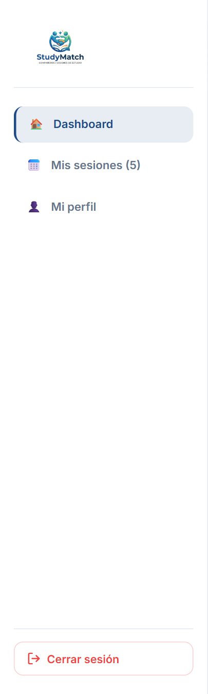
  * **Antes (móvil: la barra inferior solo tiene Inicio, Sesiones y Perfil):** 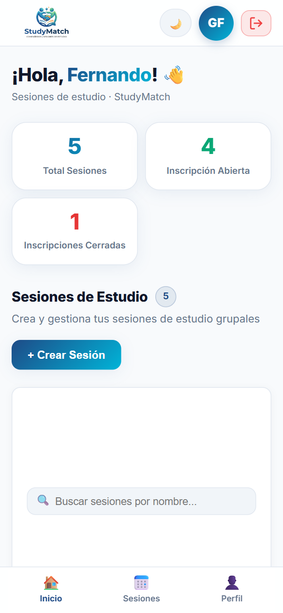
  * **Después (sidebar con "Mi historial" de 48 px):** 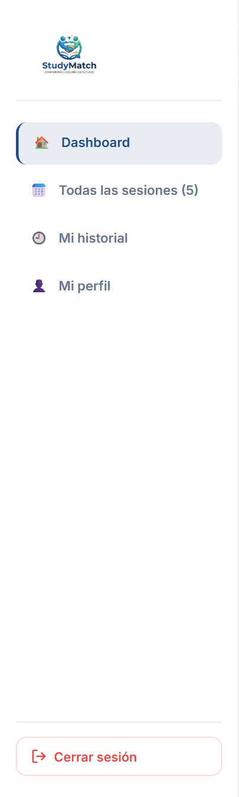
  * **Después (móvil: "Historial" en la barra inferior):** 
  * **Después (estado vacío con acción grande "Buscar sesiones"):** 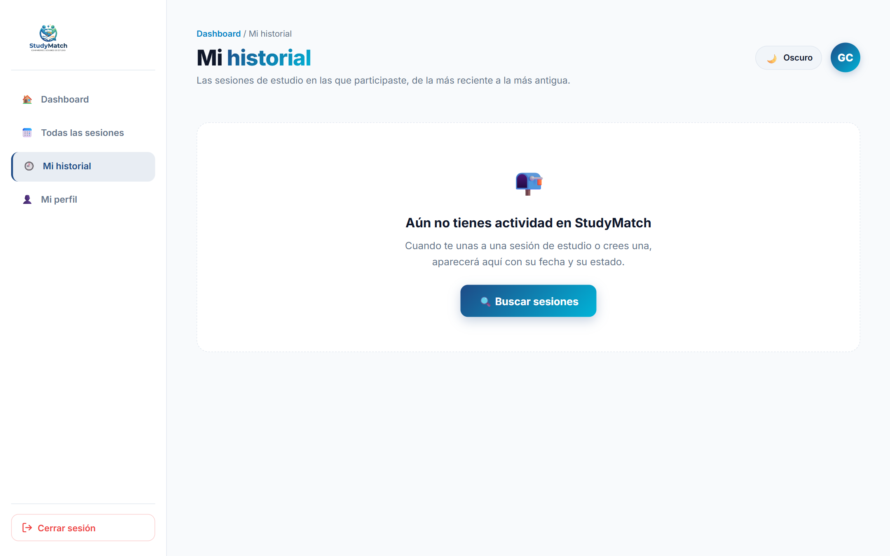

---

```
===============================================================================
Decisión 2 · Ley de Hick: tipos de evento y filtros organizados
===============================================================================
```
* **Principio de clase:** *"Los tipos de eventos, estados o filtros no compiten todos sin organización."*
* **Problema observado (antes):** Para intentar saber en qué sesiones participó, la persona solo contaba con la barra de filtros del Dashboard: **5 controles al mismo nivel visual** (buscador, materia, modalidad, fecha y disponibilidad), y **ninguno** respondía la pregunta. Cuantas más opciones equivalentes compiten, mayor es el tiempo de decisión.
* **Ubicación en pantalla:** Parte superior de la página *Mi historial*.
* **Decisión aplicada:**
  1. Los cuatro tipos de evento del sistema (`unido`, `creada`, `cerrada`, `eliminada`) se **agrupan en solo tres opciones** con significado para el estudiante, dentro de **un único control segmentado**:
     ```jsx
     // Hick: solo tres opciones, agrupadas en un único control (Issue #15)
     const FILTERS = [
       { key: 'todos', label: 'Todas', types: null },
       { key: 'unido', label: 'Me uní', types: ['unido'] },
       { key: 'creada', label: 'Organicé', types: ['creada', 'cerrada', 'eliminada'] },
     ]
     ```
  2. Cada opción muestra su **cantidad** (`Todas 5 · Me uní 2 · Organicé 3`), así la persona sabe antes de elegir qué va a encontrar.
  3. Los **estados** (*Inscripción abierta, Inscripción cerrada, Finalizada, Sesión eliminada*) **no son filtros**: se muestran como etiquetas en cada evento y no agregan decisiones nuevas.
  4. Una frase de resumen responde directamente la pregunta sin elegir nada: *"Te uniste a 2 sesiones y organizaste 3."*
  5. El mismo agrupamiento existe en la API (`GET /history/me?tipo=todos|unido|creada`) para que la interfaz y la consulta usen las mismas reglas.
* **Referencia al código:**
  * Opciones agrupadas y conteos: [`frontend/src/pages/History.jsx:L11-L16`](../frontend/src/pages/History.jsx#L11-L16) y [`frontend/src/pages/History.jsx:L105-L116`](../frontend/src/pages/History.jsx#L105-L116).
  * Control segmentado: [`frontend/src/pages/History.jsx:L186-L210`](../frontend/src/pages/History.jsx#L186-L210) y [`frontend/src/styles/History.css:L30-L79`](../frontend/src/styles/History.css#L30-L79).
  * Agrupamiento en la consulta: [`backend/app/history.py:L9-L32`](../backend/app/history.py#L9-L32).
* **Evidencia gráfica:**
  * **Antes (5 controles compitiendo y ninguno responde "¿en cuáles participé?"):** 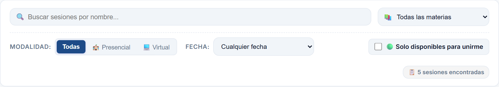
  * **Después (un control de 3 opciones con cantidades):** 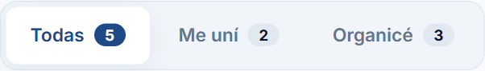
  * **Después (filtro "Me uní" aplicado):** 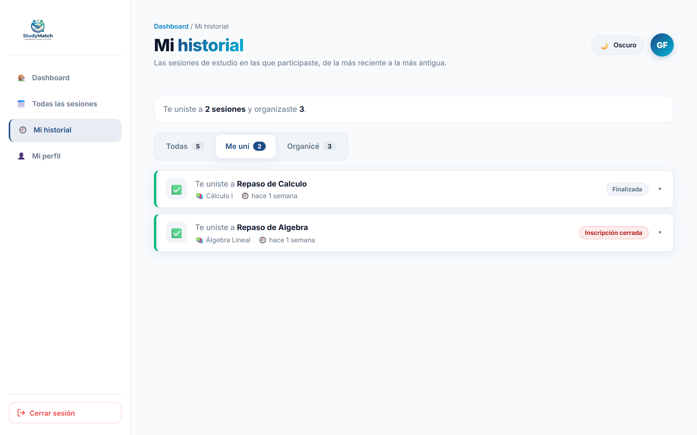

---

```
===============================================================================
Decisión 3 · Carga cognitiva: cada evento se entiende sin recordar otras pantallas
===============================================================================
```
* **Principio de clase:** *"Cada evento muestra primero lo necesario y permite comprender qué pasó sin recordar otras pantallas."*
* **Problema observado (antes):**
  * La única forma de reconstruir la participación era recorrer la grilla del Dashboard **tarjeta por tarjeta** y recordar cuáles eran propias.
  * En sesiones **finalizadas** o **cerradas**, la tarjeta solo mostraba *"Sesión finalizada"* o *"Inscripción cerrada"*; **no indicaba que el usuario había participado** (caso real: *Repaso de Calculo* y *Repaso de Algebra* del usuario de prueba).
  * No existía el dato de **cuándo** ocurrió la participación, y si la sesión se eliminaba, la participación desaparecía.
* **Ubicación en pantalla:** Lista de eventos de *Mi historial*.
* **Decisión aplicada:**
  1. **Primero lo necesario, en una línea:** ícono + verbo en lenguaje natural + nombre de la sesión, luego materia y tiempo relativo, y a la derecha la etiqueta del estado actual:
     ```jsx
     // Carga cognitiva: cada tipo de evento se reconoce por ícono y verbo, sin recordar otras pantallas
     const EVENT_META = {
       unido: { icon: '✅', verb: 'Te uniste a', tone: 'joined' },
       creada: { icon: '✨', verb: 'Creaste', tone: 'created' },
       cerrada: { icon: '🔒', verb: 'Cerraste las inscripciones de', tone: 'closed' },
       eliminada: { icon: '🗑️', verb: 'Eliminaste', tone: 'deleted' },
     }
     ```
  2. Las cuatro preguntas de la Diapositiva 20 quedan respondidas en el mismo evento: **qué ocurrió** (verbo e ícono), **cuándo** (*"hace 1 semana"* y la fecha exacta al expandir), **cuál fue el resultado** (estado actual) y **qué elemento estuvo involucrado** (nombre y materia).
  3. **Detalle bajo demanda:** fecha de la sesión, modalidad, organizador, participantes y fecha exacta del registro aparecen solo al expandir, para no saturar la lista.
  4. Color lateral por tipo de evento (verde = me uní, azul = organicé) para reconocer sin leer.
  5. El evento guarda una **copia de los datos de la sesión**, así sigue siendo comprensible aunque la sesión se edite o se elimine (*"Sesión eliminada"*).
* **Referencia al código:**
  * Tipos de evento y estados: [`frontend/src/pages/History.jsx:L18-L31`](../frontend/src/pages/History.jsx#L18-L31).
  * Resumen del evento y detalle expandible: [`frontend/src/pages/History.jsx:L235-L298`](../frontend/src/pages/History.jsx#L235-L298) y [`frontend/src/styles/History.css:L180-L202`](../frontend/src/styles/History.css#L180-L202).
  * Copia de datos de la sesión en el evento: [`backend/app/models.py:L184-L223`](../backend/app/models.py#L184-L223).
  * Estado actual calculado: [`backend/app/history.py:L35-L47`](../backend/app/history.py#L35-L47).
* **Evidencia gráfica:**
  * **Antes (hay que revisar una por una; en *Repaso de Calculo* y *Repaso de Algebra* no se indica la participación):** 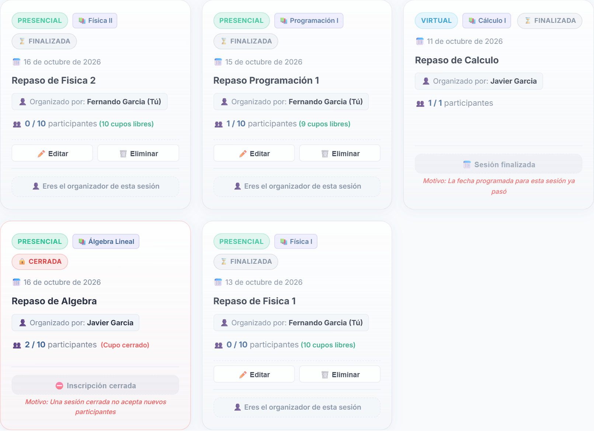
  * **Después (cada evento dice qué, cuándo, con qué sesión y su estado; detalle bajo demanda):** 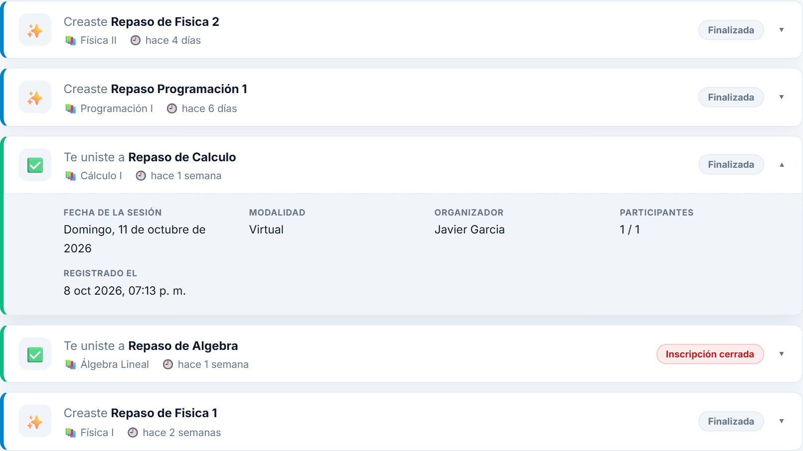

---

## ✅ Recorrido Funcional Completo (Diapositiva 22)

| Requisito | Cómo se cumple | Evidencia |
|---|---|---|
| **Una acción genera o conserva el evento** | Unirse, crear, cerrar y eliminar registran un evento en la tabla `session_history`. Al eliminar una sesión, sus eventos se conservan con la copia de sus datos. Las participaciones previas se migraron al iniciar el backend. | [`backend/app/routers/sessions.py:L50`](../backend/app/routers/sessions.py#L50), [`L122`](../backend/app/routers/sessions.py#L122), [`L276`](../backend/app/routers/sessions.py#L276), [`L307`](../backend/app/routers/sessions.py#L307) · Pruebas `test_01`, `test_02`, `test_07`, `test_10` |
| **El usuario correcto consulta su historial** | `GET /history/me` identifica al usuario por su token JWT; no acepta un id por parámetro. Sin token responde `401`. | [`backend/app/routers/history.py:L13-L51`](../backend/app/routers/history.py#L13-L51) · Prueba `test_04` |
| **Los datos permanecen después de recargar** | Los eventos se leen desde PostgreSQL en cada carga de la página. |  |
| **Existe un estado vacío** | Mensaje que explica qué aparecerá y botón **"Buscar sesiones"** que lleva a la sección de sesiones. También hay mensajes vacíos por filtro, estado de carga y error con **"Reintentar"**. | 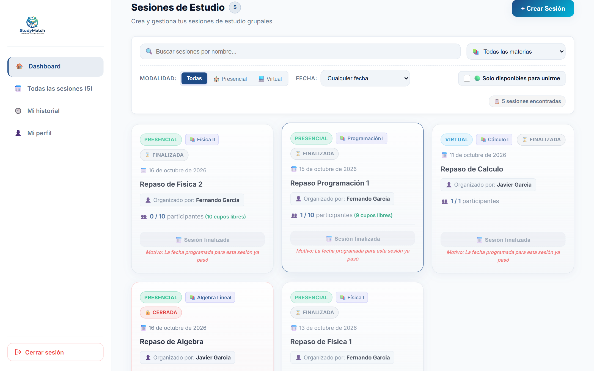 |
| **Al menos una prueba** | 10 pruebas en `backend/tests/test_session_history.py`; la suite completa pasa (**32 pruebas**). | Ver sección de pruebas |

> **Nota sobre datos migrados:** antes de esta funcionalidad no se guardaba la hora en que alguien se unía a una sesión. Para los eventos migrados se usa la fecha de creación de la sesión como referencia; los eventos nuevos registran la hora exacta.

### Evidencia adicional

* **Antes (la ruta `/historial` no existía y redirigía al inicio):** 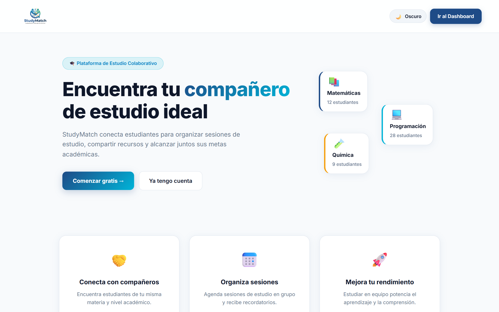
* **Después (vista completa en escritorio):** 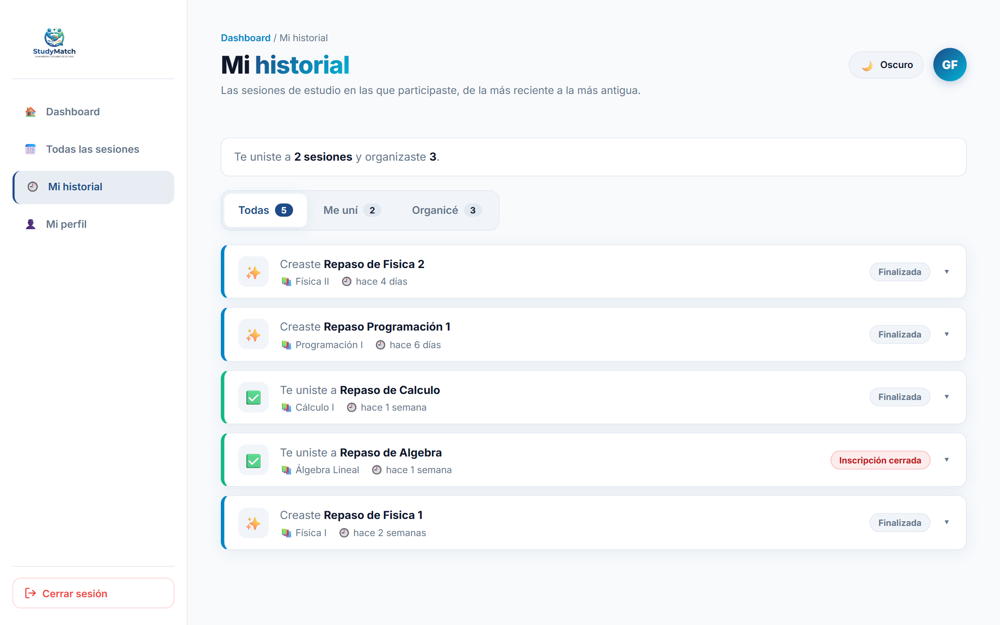
* **Después (vista móvil):** 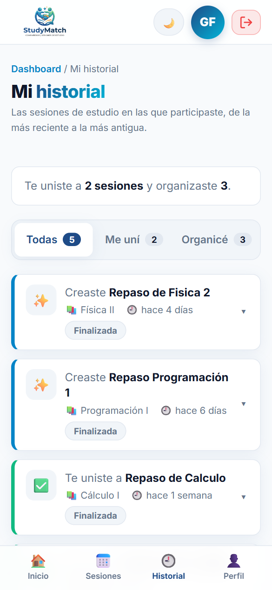
* **Después (modo oscuro consistente):** 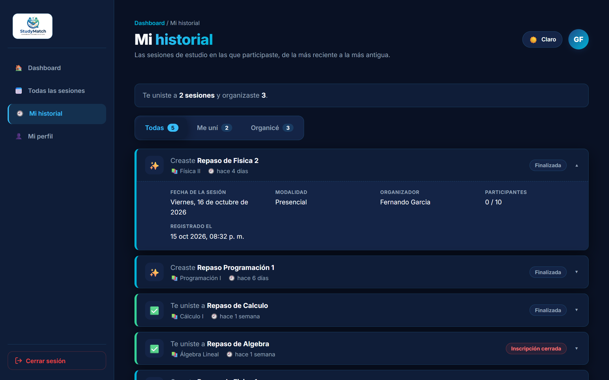

---

## 🧪 Pruebas Automáticas

Archivo: [`backend/tests/test_session_history.py`](../backend/tests/test_session_history.py) (SQLite en memoria, aislado de los datos reales).

| Prueba | Qué comprueba |
|---|---|
| `test_01_unirse_genera_evento_unido` | Unirse a una sesión crea el evento `unido` con la sesión y la fecha. |
| `test_02_crear_genera_evento_creada` | Crear una sesión crea el evento `creada`. |
| `test_03_unirse_rechazado_no_genera_evento` | Si la regla rechaza unirse (fecha pasada), no se registra nada. |
| `test_04_consulta_solo_devuelve_eventos_del_usuario` | La consulta solo devuelve eventos del usuario correcto. |
| `test_05_orden_mas_reciente_primero` | Orden comprensible: el más reciente primero. |
| `test_06_usuario_sin_eventos_obtiene_lista_vacia` | Un usuario nuevo recibe una lista vacía (estado vacío). |
| `test_07_evento_se_conserva_al_eliminar_la_sesion` | Al eliminar la sesión, los eventos se conservan con sus datos. |
| `test_08_filtro_por_tipo` | Los filtros `todos`, `unido` y `creada` devuelven lo esperado; un filtro inválido se rechaza. |
| `test_09_estado_actual_de_la_sesion` | El estado actual se calcula como abierta, cerrada, finalizada o eliminada. |
| `test_10_migracion_no_duplica_eventos` | La migración de datos existentes no duplica eventos. |

```bash
# Solo las pruebas del historial
docker exec studymatch_backend python -m unittest tests.test_session_history -v

# Suite completa (32 pruebas)
docker exec studymatch_backend python -m unittest discover -s tests -v
```

---

## 🛠️ Sub-issues y Commits

Trazabilidad según la **Diapositiva 22**: un sub-issue por parte (datos, consulta, interfaz, pruebas y evidencia), commits relacionados mediante `#número` y el **issue principal #12 abierto hasta la revisión**.

| Sub-issue | Alcance | Archivos | Commit relacionado |
|---|---|---|---|
| — (#12 principal) | Documentación de la funcionalidad y estado antes | `README.md`, `docs/evidencias/tarea-04/antes/` | `docs(historial): documentar funcionalidad y capturas del estado antes (ref #12)` |
| **#13** Datos | Tabla `session_history`, registro de eventos y migración | `backend/app/models.py`, `backend/app/routers/sessions.py`, `backend/app/triggers.py` | `feat(historial): tabla de eventos y registro al unirse, crear, cerrar y eliminar (closes #13, ref #12)` |
| **#14** Consulta | `GET /history/me` del usuario autenticado | `backend/app/history.py`, `backend/app/routers/history.py`, `backend/app/schemas.py`, `backend/app/main.py` | `feat(historial): endpoint GET /history/me del usuario autenticado (closes #14, ref #12)` |
| **#16** Pruebas | 10 pruebas de consulta, orden, usuario correcto y conservación | `backend/tests/test_session_history.py` | `test(historial): pruebas de consulta, orden y conservacion de eventos (closes #16, ref #12)` |
| **#15** Interfaz | Página *Mi historial*, accesos, filtros, detalle y estado vacío | `frontend/src/pages/History.jsx`, `frontend/src/styles/History.css`, `frontend/src/App.jsx`, `frontend/src/pages/Dashboard.jsx`, `frontend/src/pages/Profile.jsx`, `frontend/src/styles/Dashboard.css` | `feat(historial): pagina Mi historial con filtros, detalle y estado vacio (closes #15, ref #12)` |
| **#17** Evidencia | Este documento y capturas del después | `docs/decisiones-interaccion.md`, `docs/evidencias/tarea-04/despues/` | `docs(historial): decisiones de interaccion Fitts, Hick y carga cognitiva (closes #17, ref #12)` |

---

## ☑️ Criterios de Terminado (Diapositiva 24)

- [x] El issue y sus sub-issues explican el alcance (#12 y #13–#17).
- [x] El historial usa datos reales y pertenece al usuario correcto (PostgreSQL + JWT).
- [x] El orden y los estados se entienden (más reciente primero, etiquetas de estado).
- [x] El estado vacío orienta qué hacer después ("Buscar sesiones").
- [x] Una prueba comprueba la consulta o regla principal (10 pruebas).
- [x] Las tres decisiones tienen antes, después y código (este documento).
