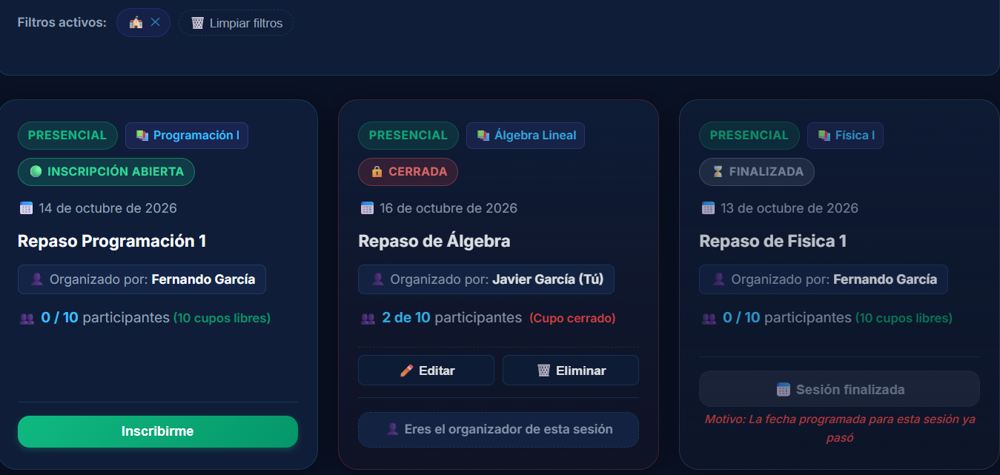
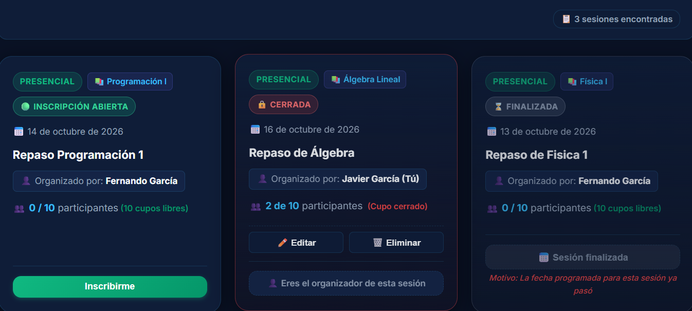
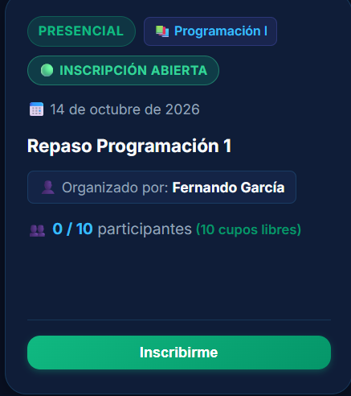
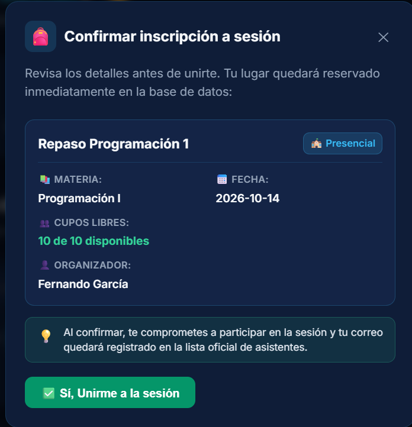
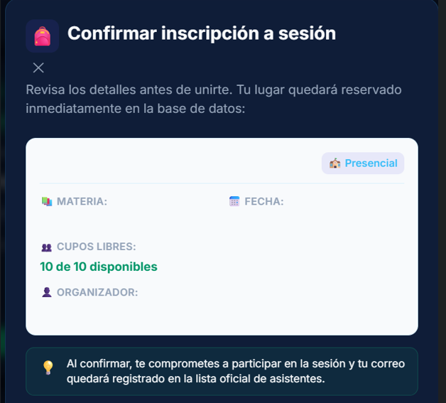
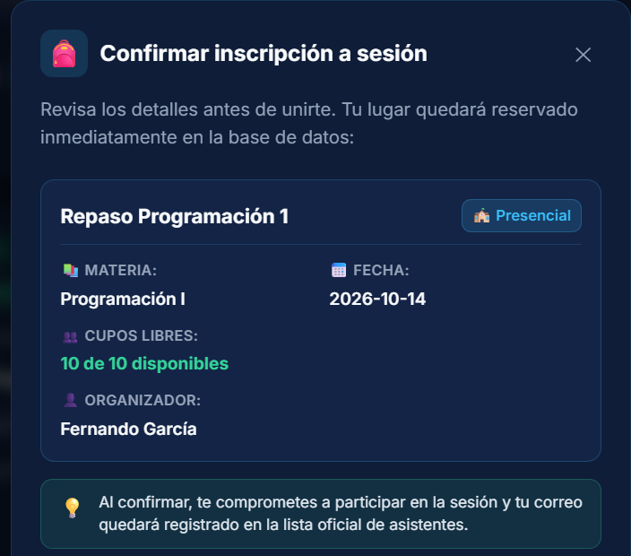
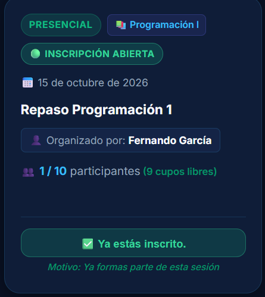
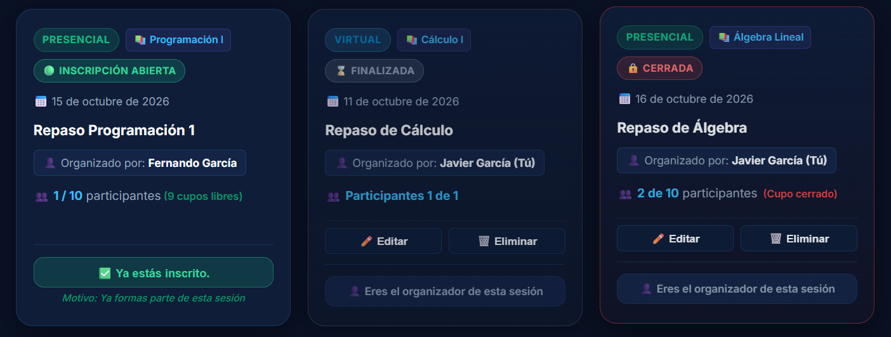
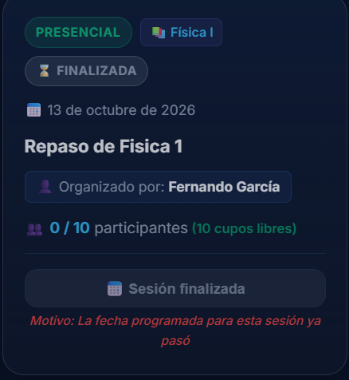
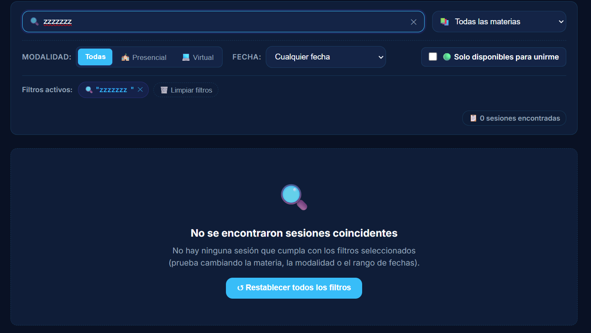

# 📋 Informe Oficial de Evaluación Heurística (H1–H10)
**Proyecto:** StudyMatch 📚🤝  
**Materia:** Interacción Hombre-Computador (ELC106)  
**Clase:** Clase 15 · Heurísticas de Nielsen (Tarea 3)  
**Funcionalidad evaluada:** *"Encontrar una sesión de estudio y unirse"*  
**Issue Principal en GitHub:** [#6 (Evaluación heurística H1–H10)](https://github.com/FernandojCg737/2do_Proyeccto_IHC/issues/6)  
**Fecha de entrega:** Jueves 15 de octubre de 2026  

---

## 📑 Resumen Ejecutivo de la Evaluación

Siguiendo las directrices académicas de la **Clase 15 (Diapositivas 20 y 21)**, se evaluó de forma rigurosa el flujo completo de la funcionalidad asignada (**"Encontrar una sesión y unirse"**). 

> **Regla de oro docente:** *"Cada H1–H10 debe terminar como 'cumple' o 'corregida', con evidencia. Una afirmación sin ubicación, captura y código no cuenta."*

### Matriz de Cumplimiento de las 10 Heurísticas

| Heurística | Pregunta Guía de Clase | Estado | Severidad Inicial | Hallazgo y Corrección Aplicada |
|---|---|:---:|:---:|---|
| **H1: Visibilidad del estado** | *¿Sé qué está pasando y entiendo el lenguaje?* | **Corregida** | 2 *(Menor)* | No había contador de sesiones encontradas al filtrar. Se implementó el badge dinámico `📋 X sesiones encontradas` y estado `⏳ Buscando...`. |
| **H2: Relación con el mundo real** | *¿Sé qué está pasando y entiendo el lenguaje?* | **Cumple** | — | Términos estudiantiles comprensibles (*"Presencial"*, *"Virtual"*, *"Cupos disponibles"*), sin jerga técnica de base de datos. |
| **H3: Control y libertad** | *¿Puedo corregir una decisión y encuentro patrones conocidos?* | **Corregida** | 3 *(Mayor)* | Al presionar *"Inscribirme"* no había salida para cancelar. Se incorporó botón de salida de emergencia `Cancelar` en el diálogo modal. |
| **H4: Consistencia y estándares** | *¿Puedo corregir una decisión y encuentro patrones conocidos?* | **Corregida** | 2 *(Menor)* | En Modo Oscuro el modal presentaba fondo blanco con texto blanco invisible. Se corrigió unificando variables `--surface2` y contraste dinámico. |
| **H5: Prevención de errores** | *¿La interfaz evita el error y reduce lo que debo recordar?* | **Corregida** | 3 *(Mayor)* | Clic accidental provocaba inscripción irreversible inmediata. Se implementó diálogo modal previo con resumen completo antes de confirmar. |
| **H6: Reconocer antes que recordar** | *¿La interfaz evita el error y reduce lo que debo recordar?* | **Corregida** | 2 *(Menor)* | Las tarjetas solo mostraban cifras numéricas brutas forzando a restas mentales. Se agregaron indicadores de cupos libres y alerta animada de último cupo. |
| **H7: Flexibilidad y eficiencia** | *¿La tarea es eficiente sin llenar la pantalla de ruido?* | **Cumple** | — | Filtros combinables con debounce de 300ms, chips removibles con ✕ y switch directo *"🟢 Solo disponibles para unirme"*. |
| **H8: Diseño estético y minimalista** | *¿La tarea es eficiente sin llenar la pantalla de ruido?* | **Cumple** | — | Tarjetas limpias, jerarquía visual cuidada y alto contraste en Modo Claro y Modo Oscuro. |
| **H9: Reconocer y recuperarse de errores** | *Cuando algo falla, ¿sé qué pasó y cómo continuar?* | **Cumple** | — | Explicación explícita del motivo ante restricciones *(caso citado en Diapositiva 11)*: sesión cerrada, fecha pasada, aforo completo o ya inscrito. |
| **H10: Ayuda y documentación** | *Cuando algo falla, ¿sé qué pasó y cómo continuar?* | **Cumple** | — | Estado vacío (*Empty State*) amigable con mensaje guía y botón de acción directa `↺ Restablecer todos los filtros`. |

---

## 🔍 Fichas Técnicas Detalladas (H1 a H10)

```
===============================================================================
H1 · Visibilidad del estado del sistema
===============================================================================
```
* **Pregunta guía:** *¿Sé qué está pasando y entiendo el lenguaje?*
* **Definición de clase:** *"La interfaz informa oportunamente qué está ocurriendo y cuál fue el resultado."*
* **Estado:** **`Corregida`**
* **Problema observado:** Al utilizar el campo de búsqueda por texto o seleccionar materias y modalidades, la lista se filtraba reactivamente pero el usuario no recibía información cuantitativa sobre el alcance del resultado. Debía desplazarse verticalmente y contar una por una las tarjetas para saber cuántas sesiones coincidían.
* **Severidad:** **2 (Problema Menor)**
* **Ubicación en pantalla:** Dashboard $\rightarrow$ Barra de filtros de sesiones.
* **Referencia al código:** [`frontend/src/pages/Dashboard.jsx:L668-L673`](../frontend/src/pages/Dashboard.jsx#L668-L673) y [`frontend/src/styles/Dashboard.css:L2020-L2035`](../frontend/src/styles/Dashboard.css#L2020-L2035).
* **Solución aplicada:**
  1. Se implementó el badge reactivo en la barra de filtros:
     ```jsx
     <div className="filter-results-status">
       <span className="filter-results-badge">
         {loadingSessions ? '⏳ Buscando sesiones...' : `📋 ${sessions.length} ${sessions.length === 1 ? 'sesión encontrada' : 'sesiones encontradas'}`}
       </span>
     </div>
     ```
  2. Informa en tiempo real tanto el estado de carga como el total exacto de coincidencias encontradas.
* **Evidencia gráfica:**
  * **Antes (Sin indicador cuantitativo ni estado de búsqueda al filtrar):** 
  * **Después (Badge dinámico de resultados y estado de carga):** 

---

```
===============================================================================
H2 · Relación entre el sistema y el mundo real
===============================================================================
```
* **Pregunta guía:** *¿Sé qué está pasando y entiendo el lenguaje?*
* **Definición de clase:** *"La interfaz utiliza palabras, conceptos y orden comprensibles para sus usuarios."*
* **Estado:** **`Cumple`**
* **Ubicación en pantalla:** Tarjetas de sesión de estudio y selectores de filtros.
* **Cómo se comprobó:**
  * Toda la terminología refleja el entorno universitario real del estudiante: *"Materia"*, *"Modalidad Presencial / Virtual"*, *"Fecha"*, *"Horario"*, *"Organizado por"* y *"Cupos disponibles"*.
  * No se exponen nombres de columnas técnicas de la base de datos (como `participants_count`, `creator_email`, `is_active` o `spots_max`).
* **Referencia al código:** [`frontend/src/pages/Dashboard.jsx:L860-L890`](../frontend/src/pages/Dashboard.jsx#L860-L890).
* **Evidencia gráfica:**
  * Captura de tarjeta con lenguaje universitario real (*Presencial, Materia, Fecha, Cupos disponibles*): 

---

```
===============================================================================
H3 · Control y libertad del usuario
===============================================================================
```
* **Pregunta guía:** *¿Puedo corregir una decisión y encuentro patrones conocidos?*
* **Definición de clase:** *"La persona puede cancelar, volver o salir de una acción iniciada por error."*
* **Estado:** **`Corregida`**
* **Problema observado:** Anteriormente, presionar el botón *"Inscribirme"* disparaba la petición de inscripción inmediatamente hacia la base de datos. Si el usuario hacía clic por error (*misclick* en pantalla táctil o ratón), quedaba registrado sin opción de arrepentirse o cancelar la operación antes de persistirla.
* **Severidad:** **3 (Problema Mayor)**
* **Ubicación en pantalla:** Flujo de inscripción desde la tarjeta de sesión.
* **Referencia al código:** [`frontend/src/pages/Dashboard.jsx:L1318-L1325`](../frontend/src/pages/Dashboard.jsx#L1318-L1325) y [`frontend/src/pages/Dashboard.jsx:L1240`](../frontend/src/pages/Dashboard.jsx#L1240).
* **Solución aplicada:**
  1. Se agregó una "salida de emergencia" clara antes de comprometer los datos:
     ```jsx
     <button type="button" className="btn-cancel" onClick={() => setSessionToJoin(null)}>
       Cancelar
     </button>
     ```
  2. El usuario puede abortar la acción presionando el botón `Cancelar`, haciendo clic en el icono `✕` o haciendo clic fuera del modal en el overlay.
* **Evidencia gráfica:**
  * **Antes (Sin botón cancelar ni salida de emergencia):** 
  * **Después (Con botón Cancelar y salida de emergencia):** 

---

```
===============================================================================
H4 · Consistencia y estándares
===============================================================================
```
* **Pregunta guía:** *¿Puedo corregir una decisión y encuentro patrones conocidos?*
* **Definición de clase:** *"Las mismas palabras, estados y controles mantienen el mismo significado."*
* **Estado:** **`Corregida`**
* **Problema observado:** Inconsistencia visual de tema entre Modo Claro y Modo Oscuro. En Modo Oscuro (`data-theme="dark"`), la tarjeta interna del modal de confirmación utilizaba un fondo blanco por defecto (`#f8fafc`) mientras que el color global de texto era blanco (`#f8fafc`), provocando que el nombre de la sesión, materia, fecha, horario y organizador fueran invisibles (texto blanco sobre tarjeta blanca).
* **Severidad:** **2 (Problema Menor)**
* **Ubicación en pantalla:** Diálogo modal de confirmación en Modo Oscuro.
* **Referencia al código:** [`frontend/src/styles/Dashboard.css:L2100-L2245`](../frontend/src/styles/Dashboard.css#L2100-L2245) y [`frontend/src/pages/Dashboard.jsx:L1244`](../frontend/src/pages/Dashboard.jsx#L1244).
* **Solución aplicada:**
  1. Se estandarizó el uso de variables `--surface2` (`#142446` en dark mode) en lugar de colores claros fijos.
  2. Se añadieron reglas explícitas para `[data-theme="dark"]` asegurando alto contraste del texto (`#f8fafc`), labels slate (`#94a3b8`) y botón `✕` alineado en la cabecera.
* **Evidencia gráfica:**
  * **Antes (Fallo de contraste blanco sobre blanco en Modo Oscuro):** 
  * **Después (Modo Oscuro consistente y legible):** 

---

```
===============================================================================
H5 · Prevención de errores
===============================================================================
```
* **Pregunta guía:** *¿La interfaz evita el error y reduce lo que debo recordar?*
* **Definición de clase:** *"El diseño evita el problema antes de que ocurra, especialmente en acciones importantes."*
* **Estado:** **`Corregida`**
* **Problema observado:** La acción de unirse a una sesión es una transacción con impacto directo (ocupa un cupo finito que priva a otro estudiante). La interfaz no prevenía el error: un misclick inscribía al estudiante a una sesión presencial u horario al que no podía asistir.
* **Severidad:** **3 (Problema Mayor)**
* **Ubicación en pantalla:** Diálogo de confirmación previa al unirse.
* **Referencia al código:** [`frontend/src/pages/Dashboard.jsx:L1240-L1335`](../frontend/src/pages/Dashboard.jsx#L1240-L1335) y [`frontend/src/styles/Dashboard.css:L2220-L2245`](../frontend/src/styles/Dashboard.css#L2220-L2245).
* **Solución aplicada:**
  1. Se implementó el modal de confirmación `modal-join-confirm` que intercepta el clic en *"Inscribirme"*.
  2. Muestra un resumen previo completo: nombre de la sesión, materia, fecha, hora, modalidad y cupos disponibles.
  3. Se solucionó el contraste de texto en Modo Oscuro (`data-theme="dark"`) asegurando que el contenido sea 100% legible antes de que el usuario pulse `✅ Sí, Unirme a la sesión`.
* **Evidencia gráfica:**
  * **Antes (Inscripción directa a ciegas):** 
  * **Después (Modal preventivo con resumen):** 

---

```
===============================================================================
H6 · Reconocer antes que recordar
===============================================================================
```
* **Pregunta guía:** *¿La interfaz evita el error y reduce lo que debo recordar?*
* **Definición de clase:** *"Las opciones y datos necesarios están visibles cuando la persona debe decidir."*  
  *(Nota académica: El docente citó expresamente este principio en la Diapositiva 9: "StudyMatch muestra cupos, fecha y modalidad junto a 'Unirme'; no obliga a volver a otra pantalla").*
* **Estado:** **`Corregida`**
* **Problema observado:** En la tarjeta de sesión, solo figuraba la cifra numérica bruta `"👥 4 / 5 participantes"`. Esto obligaba al estudiante a realizar un cálculo aritmético mental para deducir cuántos cupos libres quedaban antes de decidir unirse, y no advertía si la sesión estaba a punto de agotarse.
* **Severidad:** **2 (Problema Menor)**
* **Ubicación en pantalla:** Tarjetas de sesión de estudio en Dashboard.
* **Referencia al código:** [`frontend/src/pages/Dashboard.jsx:L894-L905`](../frontend/src/pages/Dashboard.jsx#L894-L905) y [`frontend/src/styles/Dashboard.css:L2035-L2055`](../frontend/src/styles/Dashboard.css#L2035-L2055).
* **Solución aplicada:**
  1. Se incorporó el indicador en tiempo real de plazas disponibles `(X cupos libres)`.
  2. Se añadió la alerta animada destacada `⚠️ ¡Último cupo disponible!` cuando queda exactamente 1 plaza libre, reduciendo la carga cognitiva a cero.
* **Evidencia gráfica:**
  * **Antes (Solo cifras brutas de participantes sin cálculo visible):** 
  * **Después (Cupos libres calculados explícitamente y alerta de último cupo):** 

---

```
===============================================================================
H7 · Flexibilidad y eficiencia de uso
===============================================================================
```
* **Pregunta guía:** *¿La tarea es eficiente sin llenar la pantalla de ruido?*
* **Definición de clase:** *"La interacción sirve a quien comienza y también permite avanzar con rapidez a quien ya conoce el producto."*
* **Estado:** **`Cumple`**
* **Ubicación en pantalla:** Barra de búsqueda y filtros combinables.
* **Cómo se comprobó:**
  * Para usuarios principiantes: botones directos de un clic para modalidad (*Todas*, *Presencial*, *Virtual*), selector de materia y selector rápido de fecha (*Hoy*, *Próximos 7 días*).
  * Para usuarios avanzados: búsqueda predictiva con debounce de 300 ms, filtros combinables simultáneamente, selector de rango de fechas personalizado, chips activos removibles individualmente con `✕`, botón `🗑️ Limpiar filtros` y el switch directo `🟢 Solo disponibles para unirme`.
* **Referencia al código:** [`frontend/src/pages/Dashboard.jsx:L487-L658`](../frontend/src/pages/Dashboard.jsx#L487-L658).
* **Evidencia gráfica:**
  * Captura de barra de filtros combinables, selector de materias y chips activos con botón de limpieza: 

---

```
===============================================================================
H8 · Diseño estético y minimalista
===============================================================================
```
* **Pregunta guía:** *¿La tarea es eficiente sin llenar la pantalla de ruido?*
* **Definición de clase:** *"Cada elemento visible compite por atención; lo irrelevante dificulta encontrar la acción principal."*
* **Estado:** **`Cumple`**
* **Ubicación en pantalla:** Grilla de sesiones de estudio y layout principal.
* **Cómo se comprobó:**
  * Las tarjetas priorizan los datos indispensables de la sesión con espaciado amplio, bordes redondeados (`12px`) y tipografía Inter con jerarquía clara.
  * La acción principal (*Inscribirme*) resalta con botón verde contrastante en la esquina inferior.
  * Se eliminaron fondos distractores o elementos decorativos que compitan visualmente con la información académica.
* **Referencia al código:** [`frontend/src/styles/Dashboard.css:L800-L950`](../frontend/src/styles/Dashboard.css#L800-L950).
* **Evidencia gráfica:**
  * Captura de grilla y tarjetas con diseño limpio, alto contraste y jerarquía visual: 

---

```
===============================================================================
H9 · Reconocer, diagnosticar y recuperarse de errores
===============================================================================
```
* **Pregunta guía:** *Cuando algo falla, ¿sé qué pasó y cómo continuar?*
* **Definición de clase:** *"El mensaje explica el problema con lenguaje claro y ofrece una salida concreta."*  
  *(Nota académica: El docente citó este caso en la Diapositiva 11: "No puedes unirte: la sesión ya no tiene cupos. Busca otra sesión disponible").*
* **Estado:** **`Cumple`**
* **Ubicación en pantalla:** Tarjetas de sesión con restricciones de acceso y notificaciones Toast.
* **Cómo se comprobó:**
  * Cuando el estudiante no puede inscribirse, la interfaz **no se limita a deshabilitar el botón en silencio** ni arroja códigos numéricos como `HTTP 400`; explica el motivo exacto y el contexto:
    * Sesión cerrada: `⛔ Inscripción cerrada (Motivo: Una sesión cerrada no acepta nuevos participantes)`.
    * Fecha pasada: `📅 Sesión finalizada (Motivo: La fecha programada para esta sesión ya pasó)`.
    * Cupos agotados: `👥 Cupos agotados (Motivo: Se han ocupado todos los cupos disponibles)`.
    * Ya inscrito: `✅ Ya estás inscrito (Motivo: Ya formas parte de esta sesión)`.
    * Organizador: `👤 Eres el organizador de esta sesión`.
* **Referencia al código:** [`frontend/src/pages/Dashboard.jsx:L930-L985`](../frontend/src/pages/Dashboard.jsx#L930-L985) y [`backend/app/models.py:L114-L151`](../backend/app/models.py#L114-L151).
* **Evidencia gráfica:**
  * Captura de tarjeta con explicación explícita del motivo de restricción (*Sesión finalizada*): 

---

```
===============================================================================
H10 · Ayuda y documentación
===============================================================================
```
* **Pregunta guía:** *Cuando algo falla, ¿sé qué pasó y cómo continuar?*
* **Definición de clase:** *"Cuando hace falta, la ayuda es fácil de encontrar, breve y orientada a completar una tarea."*
* **Estado:** **`Cumple`**
* **Ubicación en pantalla:** Estado vacío de búsqueda (Empty State).
* **Cómo se comprobó:**
  * Si los filtros aplicados por el usuario no coinciden con ninguna sesión activa, la aplicación no deja la pantalla vacía ni muestra un mensaje confuso.
  * Despliega un componente de ayuda con icono explicativo, mensaje orientativo (*"No hay ninguna sesión que cumpla con los filtros seleccionados (prueba cambiando la materia, la modalidad o el rango de fechas)"*) y un botón de recuperación en un clic `↺ Restablecer todos los filtros`.
* **Referencia al código:** [`frontend/src/pages/Dashboard.jsx:L1010-L1030`](../frontend/src/pages/Dashboard.jsx#L1010-L1030).
* **Evidencia gráfica:**
  * Captura de ayuda contextual y recuperación en estado vacío (*Empty State*): 

---

## 🛠️ Sub-issues y Commits de Correcciones Realizadas

De acuerdo a la **Diapositiva 20 (Punto 3)**: *"Creen un sub-issue por cada hallazgo que no cumpla y corríjanlo. Relacionen los commits mediante #número"*. Se aplicó una trazabilidad estricta 1 a 1 (1 sub-issue por cada heurística corregida):

1. **Sub-issue #7 · Prevención de errores con diálogo modal previo al unirse (H5):**
   * **Problema:** Inscripción directa sin confirmación que provocaba inscripciones accidentales irreversibles por misclick.
   * **Archivos modificados:** [`frontend/src/pages/Dashboard.jsx`](../frontend/src/pages/Dashboard.jsx), [`frontend/src/styles/Dashboard.css`](../frontend/src/styles/Dashboard.css).
   * **Commit relacionado:** `fix(ihc): dialogo modal de confirmacion previa antes de inscribirse (#7, parte de #6)`.
2. **Sub-issue #8 · Visibilidad del estado del sistema en filtros de búsqueda (H1):**
   * **Problema:** Falta de contador cuantitativo de resultados tras filtrar y falta de estado de carga oportuno.
   * **Archivos modificados:** [`frontend/src/pages/Dashboard.jsx`](../frontend/src/pages/Dashboard.jsx), [`frontend/src/styles/Dashboard.css`](../frontend/src/styles/Dashboard.css).
   * **Commit relacionado:** `feat(ihc): contador de resultados encontrados y estado de carga en filtros (#8, parte de #6)`.
3. **Sub-issue #9 · Control y libertad del usuario con botón Cancelar y salida de emergencia (H3):**
   * **Problema:** Ausencia de una salida de emergencia clara para cancelar o retractarse antes de confirmar la inscripción.
   * **Archivos modificados:** [`frontend/src/pages/Dashboard.jsx`](../frontend/src/pages/Dashboard.jsx), [`frontend/src/styles/Dashboard.css`](../frontend/src/styles/Dashboard.css).
   * **Commit relacionado:** `feat(ihc): boton cancelar y salida de emergencia en modal de confirmacion (#9, parte de #6)`.
4. **Sub-issue #10 · Consistencia de tema en Modo Oscuro para el modal de confirmación (H4):**
   * **Problema:** Inconsistencia de diseño en tema oscuro donde el modal presentaba fondo blanco con texto blanco invisible.
   * **Archivos modificados:** [`frontend/src/styles/Dashboard.css`](../frontend/src/styles/Dashboard.css).
   * **Commit relacionado:** `fix(ihc): correccion de contraste y consistencia en modo oscuro (#10, parte de #6)`.
5. **Sub-issue #11 · Reconocimiento de cupos libres y alerta de urgencia en tarjetas (H6):**
   * **Problema:** Cifras numéricas brutas ("4 / 5") que forzaban al estudiante a realizar cálculos mentales para saber si quedaba cupo.
   * **Archivos modificados:** [`frontend/src/pages/Dashboard.jsx`](../frontend/src/pages/Dashboard.jsx), [`frontend/src/styles/Dashboard.css`](../frontend/src/styles/Dashboard.css).
   * **Commit relacionado:** `feat(ihc): indicador de cupos libres y alerta de ultimo cupo en tarjetas (#11, parte de #6)`.
